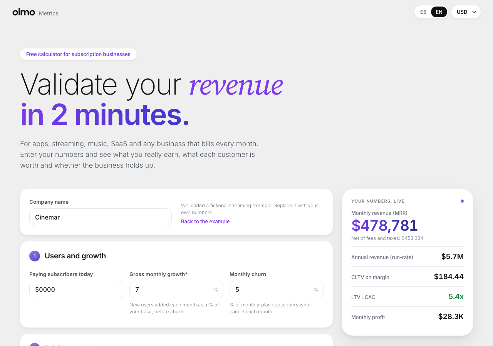

# Olmo Metrics

A free calculator for subscription businesses: apps, streaming, music, SaaS. Enter users, churn, price, payment fees, growth and costs; get MRR, annual revenue (run-rate **and** 12-month projection), CLTV, CAC, LTV:CAC, payback, profit and break-even, with a traffic-light diagnosis and a two-page A4 PDF.

**Live:** [metricas.olmo.agency](https://metricas.olmo.agency) · Spanish and English · USD, EUR, MXN, COP



The calculations run in Postgres: one SQL function, `public.calculate_metrics()`, is the single source of truth. The React app sends the inputs and renders what comes back.

## How it works

```
Inputs (React form)
  → POST /rest/v1/rpc/calculate_metrics   (debounced, on every change)
  → public.calculate_metrics(jsonb)       pure PL/pgSQL, validates and computes
  → KPIs + traffic light + 24-month projection as JSON
  → live panel, results, chart, table, print stylesheet

"Export study as PDF" / "Copy link"
  → create_study()  stores the inputs, recomputes results server-side, returns a random slug
  → /e/<slug>       anyone with the link reopens the study; editing creates a new one
  → window.print()  A4 print stylesheet, real text, Olmo branding
```

See [docs/FORMULAS.md](docs/FORMULAS.md) for every formula and a worked example, and [docs/SPEC.md](docs/SPEC.md) for the product spec (Spanish). A sample export lives at [docs/sample-study.pdf](docs/sample-study.pdf).

## What it calculates

| Group | Metrics |
|---|---|
| Revenue | Gross and net MRR, ARR run-rate, ARR projected over 12 months |
| Per subscriber | ARPU, taxes, payment fees, variable cost, contribution margin |
| Retention | Blended churn (monthly plan + annual non-renewal converted to monthly), customer lifetime |
| Value | CLTV on margin (headline) and gross CLTV |
| Acquisition | New users, net growth, CAC, LTV:CAC, CAC payback |
| Profitability | Fixed and variable costs, monthly profit, net margin, break-even users and month |

Two choices matter:

- **Growth is gross.** New users as a % of the base *before* churn, so CAC can be computed and churn's effect stays visible. The UI marks it with an asterisk.
- **CLTV is on margin.** Fees, taxes and the cost of serving each user come out before multiplying by lifetime. Gross CLTV is shown as a reference.

## Structure

```
supabase/migrations/
  20261013000001_metric_studies.sql      table, input validation, calculate_metrics(),
                                         create_study(), get_study(), attach_email(), get_benchmarks()
  20261013000002_calculate_metrics_invoker.sql
  20261013000003_round_months_once.sql
app/                                     Vite + React, no UI or chart libraries
  src/lib/api.js                         RPC calls and the useMetrics hook
  src/lib/supabase.js                    20-line fetch client (no supabase-js)
  src/lib/defaults.js                    example business, payment presets, currencies
  src/lib/i18n.js                        Spanish and English strings
  src/components/                        form, live panel, results, SVG chart
  public/olmo/                           Olmo design system tokens and self-hosted fonts
docs/                                    spec, formulas, sample PDF
```

## Data model and security

One table, `metric_studies`: slug, locale, currency, optional company name, `inputs` (validated jsonb, ≤ 4 KB), `results` (server-computed snapshot), optional `email` with `consent_at`.

- RLS is on and there are **no policies**: `anon` and `authenticated` cannot read or write the table.
- Visitors only reach it through functions with `search_path = ''`:
  - `calculate_metrics(inputs)`: `security invoker`, reads no tables.
  - `create_study(...)`: `security definer`. Validates every input (type and range), recomputes results, caps writes at 5,000 a day and returns a 12-character base62 slug (~71 bits).
  - `get_study(slug)`: returns inputs and metadata, **never the email**.
  - `attach_email(slug, email, consent)`: only with explicit consent, only within one hour of creating the study, only once.
  - `get_benchmarks()`: medians of currency-independent KPIs across distinct studies. The app shows them from 20 samples up.
- No IP addresses or other personal data are stored, apart from an email the visitor chooses to give.

## Development

```bash
cd app
cp .env.example .env    # Supabase URL and publishable key
npm install
npm run dev             # http://localhost:5174
npm test                # formatting and defaults
npm run deploy          # build + rsync to SiteGround over SSH
```

Apply the migrations in `supabase/migrations/` to a Supabase project (CLI `supabase db push` or the SQL editor). Check the engine directly:

```sql
select public.calculate_metrics('{"users": 1000, "churn_pct": 5, "price_monthly": 10}') - 'projection';
```

---

Made by [Olmo](https://olmo.agency).
